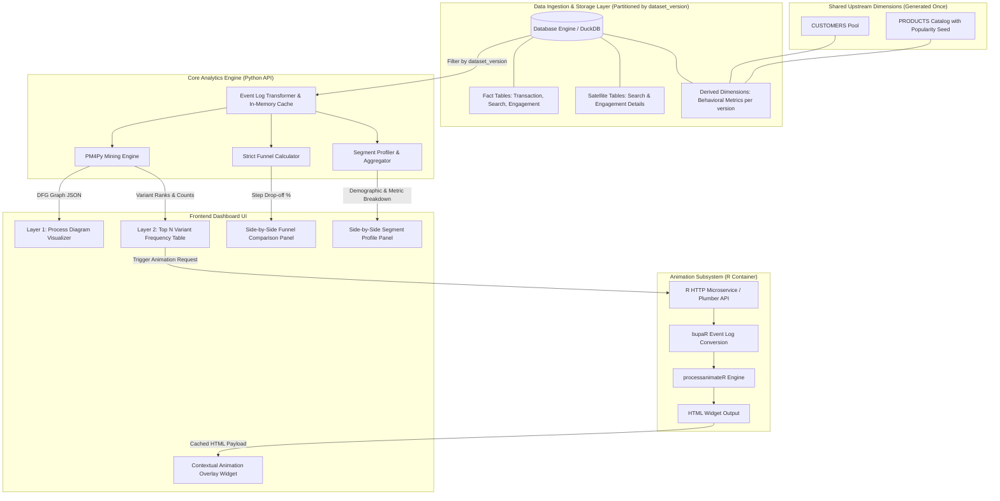
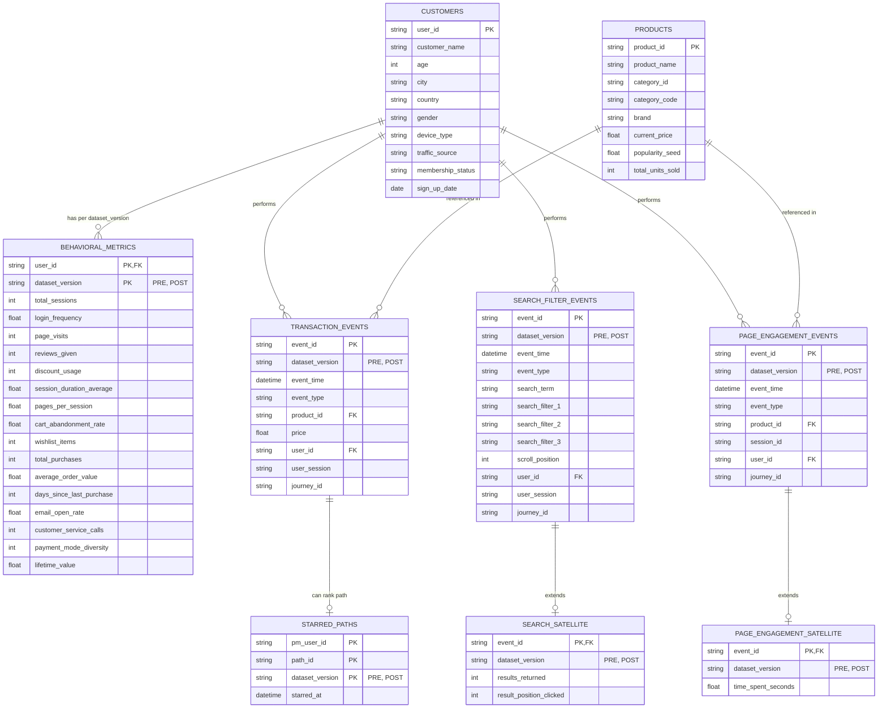
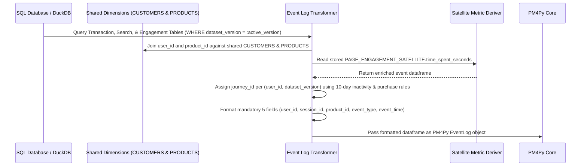

# System Architecture Specification: Customer Journey Analytics Dashboard

## 1. High-Level System Architecture

The Customer Journey Analytics Dashboard is an interactive, process-mining-powered analytics application designed to enable Product Managers (PMs) to analyze complex user behavior, discover dominant session variants, pinpoint flow bottlenecks, and evaluate segment conversion funnels.

The system is organized into four core layers:
1. **Data Ingestion & Storage Layer**: Relational/Columnar event database hosting the 9-table fact, satellite, and dimension schema partitioned/keyed by `dataset_version` (`'PRE'` | `'POST'`).
2. **Core Analytics & Process Mining Engine (Python)**: High-performance data pipeline using `PM4Py`, `Pandas`/`Polars`/`DuckDB` for trace variant mining, Directly-Follows Graph (DFG) generation, funnel calculations, and segment aggregation.
3. **Animated Replay Subsystem (R Container)**: A decoupled, trigger-based R microservice (`rocker/r-ver` + `bupaR` + `processanimateR`) providing contextual process animations rendered as interactive HTML widgets.
4. **Interactive UI & Visualization Layer**: Web dashboard integrating Layer 1 (Process Diagram), Layer 2 (Variant Frequency Table), Apache ECharts (Funnels & Segment Profiles), and interactive animation embeds.

---

## 2. Data Architecture & Pipeline

### 2.1 9-Table Relational Schema Architecture

The database architecture separates high-volume event facts from lightweight satellite metrics and user dimension attributes. Every table containing generated events or event-derived outcomes carries a `dataset_version` column (`'PRE'` | `'POST'`). To guarantee cross-version journey isolation, `journey_id` is scoped by combining it with `dataset_version` as a composite grouping key `(journey_id, dataset_version)`.

### Complete Schema Definitions & Field Specifications

1. **Table 1: Customer Attributes (`CUSTOMERS`)** — *Shared Dimension Table (Generated Once)*
   - `user_id` (PK, string): Unique customer identifier.
   - `customer_name` (string), `age` (int), `city` (string), `country` (string), `gender` (string).
   - `device_type` (string): Primary device category (`Desktop`, `Mobile`, `Tablet`).
   - `traffic_source` (string): Acquisition channel (`Direct`, `Organic Search`, `Paid Ad`, `Email`, `Social`).
   - `membership_status` (string), `sign_up_date` (date).

2. **Table 2: Customer Behavioral Metrics (`BEHAVIORAL_METRICS`)** — *Derived Table (Generated Twice, per `dataset_version`)*
   - `user_id` (PK, FK to `CUSTOMERS.user_id`).
   - `dataset_version` (PK, string: `'PRE'` | `'POST'`).
   - `total_sessions`, `login_frequency`, `page_visits`, `reviews_given`, `discount_usage`, `session_duration_average`, `pages_per_session`, `cart_abandonment_rate`, `wishlist_items`, `total_purchases`, `average_order_value`, `days_since_last_purchase`, `email_open_rate`, `customer_service_calls`, `payment_mode_diversity`, `lifetime_value`.

3. **Table 3: Products (`PRODUCTS`)** — *Shared Dimension Table (Generated Once)*
   - `product_id` (PK, string).
   - `product_name` (string), `category_id` (string), `category_code` (string), `brand` (string), `current_price` (float).
   - `popularity_seed` (float): Static pre-generation rank seed assigned independently before event generation (drawn from a Zipf distribution). Used as the input driver to sort search results "best-selling first" during event generation.
   - `total_units_sold` (int, post-hoc derived): Static analytical field calculated *after* event generation completes, representing actual aggregate purchase counts across runs.

4. **Table 4: Transactional & Session Events (`TRANSACTION_EVENTS`)**
   - `event_id` (PK, string), `dataset_version` (string: `'PRE'` | `'POST'`), `event_time` (datetime), `event_type` (`add_to_cart`, `remove_from_cart`, `purchase`, `apply_coupon`, `login`), `product_id` (FK to `PRODUCTS.product_id`), `price` (float), `user_id` (FK to `CUSTOMERS.user_id`), `user_session` (string), `journey_id` (string). *(Keyed with `dataset_version` as composite key `(journey_id, dataset_version)`)*.

5. **Table 5: Search & Filter Events (`SEARCH_FILTER_EVENTS`)**
   - `event_id` (PK, string), `dataset_version` (string: `'PRE'` | `'POST'`), `event_time` (datetime), `event_type` (`search_query`, `apply_filter`, `scroll_checkpoint`), `search_term` (string), `search_filter_1`, `search_filter_2`, `search_filter_3`, `scroll_position` (int), `user_id` (FK to `CUSTOMERS.user_id`), `user_session` (string), `journey_id` (string). *(Keyed with `dataset_version` as composite key `(journey_id, dataset_version)`)*.

6. **Table 6: Product Page Engagement Events (`PAGE_ENGAGEMENT_EVENTS`)**
   - `event_id` (PK, string), `dataset_version` (string: `'PRE'` | `'POST'`), `event_time` (datetime), `event_type` (`view_product`, `view_reviews`, `view_comparison`, `zoom_image`, `expand_description`, `check_contents`, `watch_video`, `swipe_pictures`), `product_id` (FK to `PRODUCTS.product_id`), `session_id` (string), `user_id` (FK to `CUSTOMERS.user_id`), `journey_id` (string). *(Keyed with `dataset_version` as composite key `(journey_id, dataset_version)`)*.

7. **Table 7: Search Satellite (`SEARCH_SATELLITE`)**
   - `event_id` (PK, FK to `SEARCH_FILTER_EVENTS.event_id`), `dataset_version` (string: `'PRE'` | `'POST'`), `results_returned` (int), `result_position_clicked` (int).

8. **Table 8: Product Page Engagement Satellite (`PAGE_ENGAGEMENT_SATELLITE`)**
   - `event_id` (PK, FK to `PAGE_ENGAGEMENT_EVENTS.event_id`), `dataset_version` (string: `'PRE'` | `'POST'`), `time_spent_seconds` (float).

9. **Table 9: Starred Paths (`STARRED_PATHS`)**
   - `pm_user_id` (PK, string), `path_id` (PK, string: deterministic MD5 trace hash), `dataset_version` (PK, string: `'PRE'` | `'POST'`), `starred_at` (datetime).

---

### 2.2 Event Log Assembly & Transformation Pipeline

To feed process mining algorithms, event tables are filtered by the active `dataset_version` and joined into a standardized Event Log view (`PM4Py DataFrame`).

#### 2.2.1 Journey ID (`journey_id`) Assignment & Session Grouping Logic
A `journey_id` spans multiple user sessions to capture long-term purchasing decision arcs. The assignment algorithm evaluates consecutive sessions for each `(user_id, dataset_version)` pair:

- **Inactivity Threshold**: Fixed at **10 days** ($864,000 \text{ seconds}$).
- **Assignment Logic Rule**:
  For a new session $S_{\text{new}}$ starting at $T_{\text{start}}$ belonging to `(user_id, dataset_version)`, evaluate the previous session $S_{\text{prev}}$ ending at $T_{\text{end\_prev}}$:
  $$\text{journey\_id}(S_{\text{new}}) = \begin{cases} \text{journey\_id}(S_{\text{prev}}) & \text{if } S_{\text{prev}}\text{.has\_purchase} = \text{FALSE} \text{ AND } (T_{\text{start}} - T_{\text{end\_prev}}) \le 10\text{ days} \\ \text{UUID()} & \text{if } S_{\text{prev}}\text{.has\_purchase} = \text{TRUE} \text{ OR } (T_{\text{start}} - T_{\text{end\_prev}}) > 10\text{ days} \end{cases}$$
- **Closing Triggers**: A journey is closed upon either (1) a completed `purchase` event, or (2) reaching 10 consecutive days of inactivity with no new events.
- **Cross-Version Scoping**: Queries and trace groupings treat `(journey_id, dataset_version)` as a composite grouping key to guarantee zero ID collision between PRE and POST runs.

#### 2.2.2 Post-Hoc Duration Calculation Formula
Micro-interaction duration (`time_spent_seconds`) is computed post-hoc from consecutive event timestamps within the same session:
$$\text{time\_spent\_seconds}_i = \text{event\_time}_{i+1} - \text{event\_time}_i \quad \text{where } \text{session\_id}_i = \text{session\_id}_{i+1}$$

---

## 3. Core Analytics Subsystem (Python & PM4Py)

### 3.1 Trace Variant Extraction & Deterministic Path Hash Engine
The variant extraction engine mines discrete trace sequences across user sessions for a target `dataset_version`, generates deterministic path IDs, and aggregates frequency counts:

1. **Trace Formation**: Group unified event log (filtered by `dataset_version`) by `(user_session, dataset_version)` (or `(journey_id, dataset_version)`), ordered by `event_time`.
2. **Deterministic Path ID Hash Formula**:
   $$\text{path\_signature} = E_1 \parallel \text{"|"} \parallel E_2 \parallel \text{"|"} \parallel \dots \parallel \text{"|"} \parallel E_k$$
   $$\text{path\_id} = \text{MD5}(\text{path\_signature})$$
3. **Frequency Aggregation**: Calculate variant frequency counts and session percentages for that `dataset_version`.

---

## 4. Animation Subsystem (R & processanimateR Container)
R animation microservice filters tokens by `(path_id, dataset_version)`.

---

## 5. Frontend & UI Interaction Architecture
UI state management queries `(journey_id, dataset_version)` and `(path_id, dataset_version)`.

---

## 6. Synthetic Dataset Generator Subsystem
Generates events per `dataset_version` using shared `CUSTOMERS` and `PRODUCTS`.

---

## 7. Performance & Infrastructure Constraints
Indexes created on `(dataset_version, user_session)`, `(journey_id, dataset_version)`, and `(user_id, dataset_version)`.

---

## 8. Non-Functional Scope Boundaries
Scope boundaries per Decision 15.
