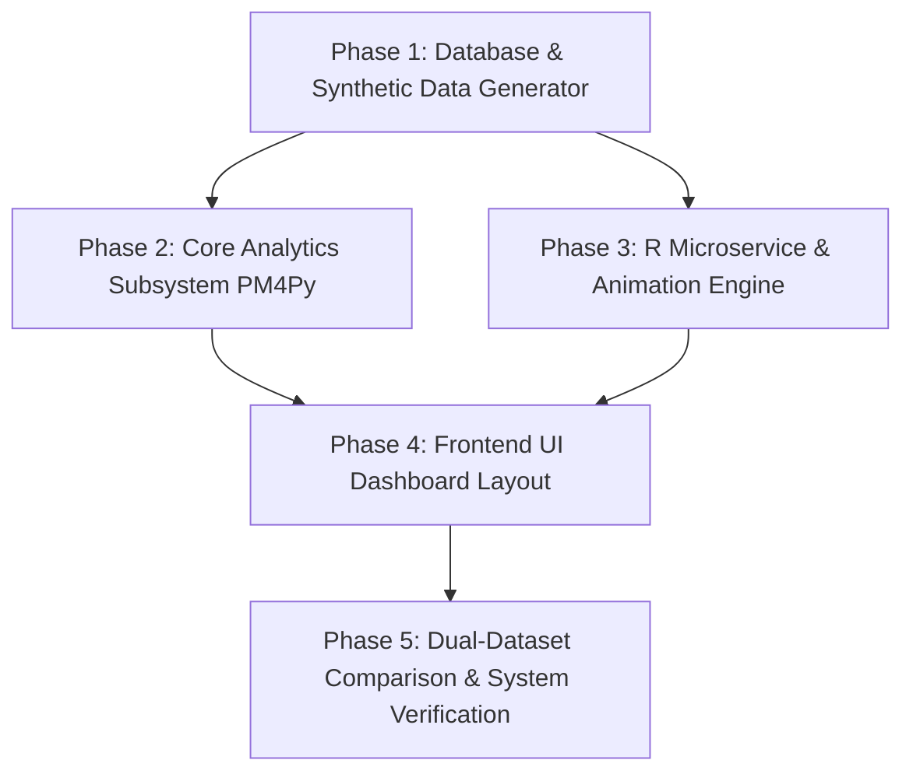

# Implementation Plan: Customer Journey Analytics Dashboard

A systematic, 5-phase plan to implement the Customer Journey Analytics Dashboard based on the System Architecture Specification ([architecture.md](file:///c:/Projects/Customer%20journey%20project/architecture.md)), Project Context ([context.md](file:///c:/Projects/Customer%20journey%20project/context.md)), and Corner Scenarios ([edge-case.md](file:///c:/Projects/Customer%20journey%20project/edge-case.md)).

---

## User Review Required

> [!IMPORTANT]
> **Key Architecture Choices to Confirm:**
> 1. **Data Storage Engine**: DuckDB is selected as the in-memory columnar SQL database for sub-second event log queries over 1,000,000 rows.
> 2. **R Animation Container**: R `Plumber` microservice running `rocker/r-ver` + `bupaR` + `processanimateR` deployed as a local Docker container (memory capped at 4 GB).
> 3. **Shared Dimensions vs. Versioned Outcomes & Scoping**:
>    - **Shared Dimensions (Generated Once)**: `CUSTOMERS` (attributes, `device_type`, `traffic_source`) and `PRODUCTS` (catalog, Zipf `popularity_seed`).
>    - **Versioned Facts & Satellite Tables (Tagged with `dataset_version`)**: `TRANSACTION_EVENTS`, `SEARCH_FILTER_EVENTS`, `PAGE_ENGAGEMENT_EVENTS`, `SEARCH_SATELLITE`, and `PAGE_ENGAGEMENT_SATELLITE`.
>    - **Cross-Version Journey Isolation**: `journey_id` is scoped with `dataset_version` as a composite grouping key `(journey_id, dataset_version)` across all queries, trace mining, and segment profiling.
>    - **Derived Metrics per Version**: `BEHAVIORAL_METRICS` is **NOT** a shared table. It is computed separately for each `dataset_version`, keyed on `(user_id, dataset_version)`, from that version's event stream.

---

## Proposed Implementation Phases

---

### Phase 1: Shared Database Schema & Synthetic Generator Engine

#### Overview
Build the DuckDB relational schema (9 tables with `dataset_version` tags and `(journey_id, dataset_version)` composite keys) and implement the 2-stage synthetic dataset generator that produces 1,000,000 event rows per version.

#### Tasks
- [x] **Database Setup**: Create DuckDB schema for the 9 tables:
  - Shared: `CUSTOMERS`, `PRODUCTS`.
  - Derived: `BEHAVIORAL_METRICS` (PK: `user_id`, `dataset_version`).
  - Fact & Satellite: `TRANSACTION_EVENTS`, `SEARCH_FILTER_EVENTS`, `PAGE_ENGAGEMENT_EVENTS`, `SEARCH_SATELLITE`, `PAGE_ENGAGEMENT_SATELLITE` (all carrying `dataset_version: 'PRE' | 'POST'`, with `journey_id` composite index `(journey_id, dataset_version)`).
  - User State: `STARRED_PATHS` (PK: `pm_user_id`, `path_id`, `dataset_version`).
- [x] **Stage 1 Generator (Shared Upstream Dimensions — Generated ONCE)**:
  - Generate `CUSTOMERS` pool with demographic attributes, `device_type` (`Desktop`, `Mobile`, `Tablet`), and `traffic_source` (`Direct`, `Organic Search`, `Paid Ad`, `Email`, `Social`).
  - Generate `PRODUCTS` catalog with Zipf-distributed `popularity_seed` ($P(k) \propto 1/k^s$).
- [x] **Stage 2 Generator (Event Stream & Satellite/Derived Table Population per `dataset_version`)**:
  - Execute Pre-Feature (`'PRE'`) and Post-Feature (`'POST'`) generation runs using shared `CUSTOMERS` & `PRODUCTS`.
  - Markov behavioral state machine (50% Look-and-Leave, 25% Fast-Buy, 25% Research-Heavy).
  - Implement **10-day inactivity threshold** ($864,000\text{s}$) and `purchase` termination rule for `(journey_id, dataset_version)` grouping. (Example: Day 1–9 browsing, Day 21 return $\rightarrow$ 12-day gap $> 10$ days $\rightarrow$ splits into 2 distinct journeys).
  - Implement search result sorting (`popularity_seed DESC`) and Pareto `result_position_clicked` sampling (80% on ranks 1–3).
  - Implement congestion dynamics: flash-sale time spikes, slow-step Gaussian checkout delays ($\mu=45\text{s}, \sigma=15\text{s}$), mobile device friction.
  - **Populate Satellite & Derived Tables in Storage**:
    - **`SEARCH_SATELLITE.results_returned`**: Write matching product candidate count at search creation time.
    - **`PAGE_ENGAGEMENT_SATELLITE.time_spent_seconds`**: Calculate and store timestamp deltas (`LEAD(event_time)`) during event generation.
    - **`BEHAVIORAL_METRICS`**: Compute and write per-user summary metrics (`total_sessions`, `cart_abandonment_rate`, `average_order_value`, `lifetime_value`, `session_duration_average`) keyed on `(user_id, dataset_version)` after stream generation completes.
  - Enforce deterministic `path_id = MD5(event_types)` hashing across both runs.

#### Automated Tests & Verification
- [x] `test_schema_integrity()`: Verify table creation, primary/foreign keys, and `dataset_version` columns.
- [x] `test_shared_dimension_consistency()`: Confirm PRE and POST event datasets reference identical `user_id` and `product_id` pools.
- [x] `test_journey_id_assignment()`: Test 10-day timeout (Day 21 return splits journeys) and purchase closing triggers.
- [x] `test_journey_id_cross_version_isolation()`: Confirm queries grouping by `(journey_id, dataset_version)` never leak journeys across dataset versions.
- [x] `test_deterministic_path_hash()`: Ensure `MD5("view_product|add_to_cart|purchase")` generates identical `path_id` across runs.
- [x] `test_behavioral_metrics_per_version()`: Confirm `BEHAVIORAL_METRICS` rows exist for both PRE and POST versions and differ meaningfully for the same `user_id`.
- [x] `test_satellite_tables_populated()`: Confirm `SEARCH_SATELLITE` (`results_returned`) and `PAGE_ENGAGEMENT_SATELLITE` (`time_spent_seconds`) are non-empty, tagged with `dataset_version`, and correctly linked via `event_id`.

---

### Phase 2: Python Process Mining & Core Analytics Subsystem

#### Tasks
- [x] **Event Log Assembly Pipeline**:
  - SQL query filtering by `WHERE dataset_version = :active_version`, joining fact tables with shared `CUSTOMERS` and `PRODUCTS`.
  - Group traces by `(journey_id, dataset_version)` or `(user_session, dataset_version)`.
  - Format 5 mandatory backbone fields (`user_id`, `session_id`, `product_id`, `event_type`, `event_time`).
- [x] **Trace Variant Extraction & Ranking Engine**:
  - Filter event log by `dataset_version`, group traces by `(journey_id, dataset_version)`, and compute deterministic `path_id = MD5(event_types)`.
  - Rank variants by session count and %, implementing Top N cutoff slider logic and `Other` row aggregation.
- [x] **DFG, Funnel & Segment Engines** (`src/analytics.py`, evals 2.2–2.4):
  - 60% cumulative-traffic DFG edge filter + orphan node pruning (`build_dfg`).
  - Strict ordered-prefix funnel math (`compute_funnel`).
  - Segment profile aggregation over shared `CUSTOMERS` + versioned `BEHAVIORAL_METRICS` with empty-cohort handling (`profile_segment`).

---

### Phase 3: R Microservice & Contextual Animation Subsystem
- [x] Plumber `POST /animate` endpoint (`r/animate.R`): bupaR eventlog, ≤1,000-token uniform downsampling, target-path token highlighting via `token_aes` ordinal scale.
- [x] Python `AnimationClient` (`src/animation_client.py`): payload assembly with journey-signature flagging, LRU cache keyed on `MD5(path_id|dataset_version|start|end)`, 5s timeout → static DFG fallback.
- [x] Container packaging: `r/Dockerfile` (rocker/r-ver) + `r/docker-compose.yml` (4 GB cap, port 8000).
- Filter tokens by `(path_id, dataset_version)` and execute `processanimateR`.

---

### Phase 4: Frontend UI Dashboard Layout & Interactive Visualizations
- Dashboard components filter by active `dataset_version` and display starred path version provenance.

---

### Phase 5: Feature-Release Comparison & End-to-End System Validation
- `activeDatasetVersion = 'COMPARISON'` triggers dual concurrent queries filtering on `WHERE dataset_version = 'PRE'` and `WHERE dataset_version = 'POST'` grouping by `(journey_id, dataset_version)`.

---

## Verification Plan
Automated & manual tests validating composite `(journey_id, dataset_version)` isolation and 10-day timeout rule.
